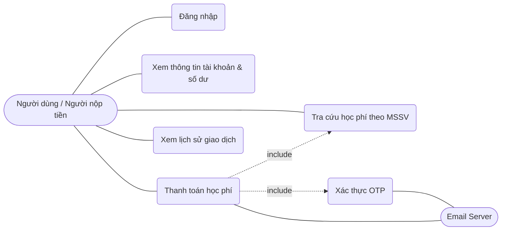
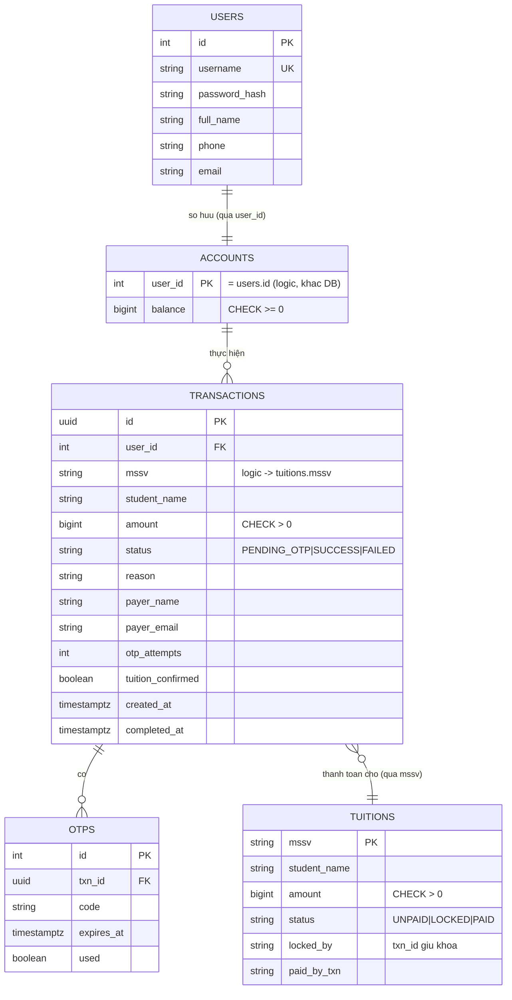
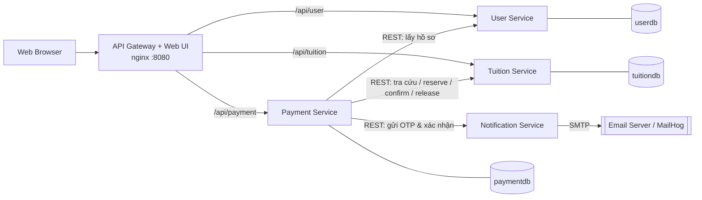
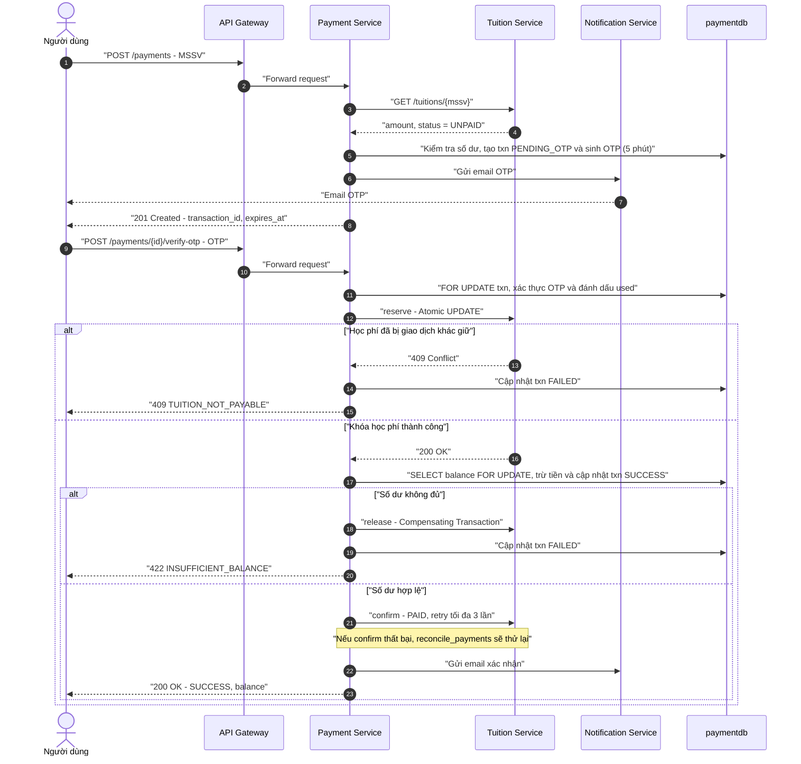

# iBanking – Phân hệ đóng học phí (Kiến trúc hướng dịch vụ – 504070)

## 1. Chạy hệ thống
Yêu cầu: Docker + Docker Compose.
```bash
docker compose up --build -d
```
| Thành phần | URL |
|---|---|
| Web UI (qua API Gateway nginx) | http://localhost:8080 |
| MailHog – xem email OTP/xác nhận | http://localhost:8025 |
| Swagger user / tuition / payment / notification | http://localhost:8001/docs · 8002 · 8003 · 8004 |

Tài khoản mẫu (mật khẩu `123456`): `sv_an`, `sv_binh`, `sv_chi` (số dư 20.000.000 ₫), `sv_dung` (1.000.000 ₫ – demo không đủ số dư).
MSSV mẫu: `52100001` (15tr), `52100002` (15tr), `52100003` (12tr), `52100004` (18,5tr), `52100005` (9tr).
Reset dữ liệu: `docker compose down -v`. Dùng SMTP thật: đặt `SMTP_HOST, SMTP_PORT, SMTP_USER, SMTP_PASS, MAIL_FROM` cho `notification-service`.

**Test tự động** (pytest, thư mục `tests/`):
```bash
pip install -r tests/requirements.txt
pytest tests/test_unit.py -v               # unit test, không cần Docker/DB
docker compose down -v && docker compose up --build -d
pytest tests -v                            # unit + API + concurrency (cần DB mới, tự skip nếu hệ thống chưa chạy)
```
| File | Nội dung |
|---|---|
| `test_unit.py` | hash mật khẩu, JWT/auth, validation (MSSV, OTP 6 số), sinh OTP (định dạng, 5 phút, chống trùng, vô hiệu OTP cũ), bù trừ `safe_release`, guard API nội bộ, nội dung email |
| `test_api.py` | đăng nhập 200/401/422, tra cứu học phí 200/401/404, gateway chặn `/internal/*`, validation, không đủ số dư, OTP sai/gửi lại/giao dịch của người khác, lịch sử chỉ của chính mình |
| `test_concurrency.py` | khóa OTP sau 5 lần sai; cùng tài khoản 2 giao dịch đồng thời (không âm tiền); 2 tài khoản cùng 1 MSSV (chỉ 1 thành công); học phí đã PAID không thanh toán lại |

**Demo thủ công:** đăng nhập → nhập MSSV → Tra cứu → tick điều khoản → *Xác nhận giao dịch* → mở MailHog lấy OTP → nhập OTP → xem kết quả / lịch sử.

## 2. Phân tích nghiệp vụ
### Use Case Diagram

### ERD (mỗi service sở hữu DB riêng; liên kết giữa service qua ID, không có FK chéo DB — FK thật chỉ có trong `paymentdb`)


## 3. Kiến trúc Microservices

| Service | Trách nhiệm | Dữ liệu sở hữu |
|---|---|---|
| API Gateway (nginx) | Phục vụ UI, định tuyến `/api/*`, chặn `/internal/*` | – |
| User Service | Đăng nhập, phát JWT, hồ sơ người dùng | `users` |
| Tuition Service | Tra cứu học phí; khóa/gạch nợ nguyên tử | `tuitions` |
| Payment Service | Tài khoản/số dư, giao dịch, OTP, transaction & concurrency (điều phối Saga) | `accounts, transactions, otps` |
| Notification Service | Gửi email OTP và xác nhận qua SMTP | – |

### Sequence diagram – luồng thanh toán


**Lý do chọn kiến trúc:** tách theo bounded context, mỗi service một DB (data ownership rõ ràng, PostgreSQL); giao tiếp REST đồng bộ vì luồng cần kết quả tức thời; email tách riêng để lỗi SMTP không ảnh hưởng lõi thanh toán; JWT dùng chung secret để mỗi service tự xác thực; API nội bộ bảo vệ bằng `X-Internal-Key` và bị gateway chặn.

## 4. REST API (URI dưới đây là URI tại service; qua gateway thêm tiền tố `/api/user|tuition|payment`)
Lỗi trả về dạng `{"detail": {"code": "...", "message": "..."}}`.

| Service | Method & URI | Request | Response | Status |
|---|---|---|---|---|
| user | `POST /auth/login` | `{username,password}` | `{access_token,user}` | 200, 401 |
| user | `GET /users/me` | Bearer | `{id,full_name,phone,email}` | 200, 401 |
| tuition | `GET /tuitions/{mssv}` | Bearer | `{mssv,student_name,amount,status}` | 200, 401, 404 |
| payment | `GET /payments/account` | Bearer | `{balance}` | 200, 401, 404 |
| payment | `GET /payments/history` | Bearer | `[ {id,mssv,student_name,amount,status,reason,created_at} ]` | 200, 401 |
| payment | `POST /payments` (Xác nhận giao dịch, gửi OTP) | `{mssv}` | `{transaction_id,expires_at,message}` | 201, 404, 409, 422 (thiếu số dư/validation), 502 |
| payment | `POST /payments/{id}/resend-otp` | – | `{transaction_id,expires_at}` | 200, 404, 409 |
| payment | `POST /payments/{id}/verify-otp` | `{otp: "6 số"}` | `{transaction_id,status,mssv,amount,balance}` | 200, 400 (OTP sai `OTP_INVALID`/hết hạn `OTP_EXPIRED`/bị khóa `OTP_LOCKED`/đã dùng), 404, 409, 422 |
| tuition (nội bộ) | `POST /internal/tuitions/{mssv}/reserve｜confirm｜release` | `{txn_id}` | `{amount｜status}` | 200, 409 |
| notification (nội bộ) | `POST /internal/notify/otp｜payment-success` | thông tin email | `{sent:true}` | 200, 502 |

## 5. Transaction & Concurrency
Hệ thống giải quyết ba thách thức quan trọng trong kiến trúc Microservices: **Overspending**, **Double-spending** và **Data Consistency**. Các cơ chế khóa dữ liệu, giao dịch bù trừ và đối soát được kết hợp nhằm đảm bảo tính an toàn và nhất quán trong quá trình thanh toán.

### 5.1. Chống Chi Tiêu Vượt Số Dư (Overspending)
**Cơ chế:** Sử dụng **Pessimistic Locking** thông qua câu lệnh `SELECT ... FOR UPDATE` trong Database Transaction của Payment Service.
**Quy trình xử lý:**
1. Payment Service lấy khóa độc quyền trên bản ghi tài khoản bằng `SELECT balance ... FOR UPDATE`.
2. Sau khi giữ được khóa, hệ thống mới kiểm tra số dư hiện tại.
3. Nếu số dư đủ, hệ thống thực hiện trừ tiền và cập nhật giao dịch trong cùng một Database Transaction.
4. Nếu số dư không đủ, giao dịch bị từ chối và dữ liệu được rollback.
**Kết quả:**
- Các giao dịch đồng thời trên cùng một tài khoản được tuần tự hóa.
- Ngăn chặn nhiều giao dịch cùng sử dụng một số dư tại cùng thời điểm.
- Ràng buộc `CHECK (balance >= 0)` tại Database đóng vai trò là lớp bảo vệ cuối cùng, đảm bảo số dư không thể âm.

### 5.2. Chống Thanh Toán Trùng Học Phí (Double-spending)
**Cơ chế:** Sử dụng **Atomic Update** tại Tuition Service để đảm bảo chỉ một giao dịch có thể giành quyền khóa một khoản học phí.
Hệ thống kiểm tra số lượng bản ghi được cập nhật:
- **Một bản ghi được cập nhật:** Giao dịch giành được quyền khóa học phí thành công.
- **Không có bản ghi nào được cập nhật:** Học phí đã được thanh toán hoặc đang được giao dịch khác giữ khóa. Service trả về HTTP `409 Conflict`.
**Kết quả:**
- Chỉ một giao dịch có thể chuyển trạng thái học phí từ `UNPAID` sang `LOCKED`.
- Các giao dịch đến sau không thể đồng thời thanh toán cùng một khoản học phí.
- Giao dịch bị từ chối sẽ không bị trừ tiền.

### 5.3. Đảm Bảo Tính Nhất Quán Giữa Các Service (Saga Pattern)
Do mỗi Microservice quản lý một Database riêng biệt, hệ thống không sử dụng một Database Transaction duy nhất cho toàn bộ quy trình thanh toán. Thay vào đó, **Saga Pattern** được áp dụng kết hợp với các bước bù trừ (*Compensating Transactions*) và cơ chế đối soát (*Reconciliation*).
**Quy trình thanh toán:**
1. **Reserve:** Tuition Service khóa khoản học phí, chuyển trạng thái từ `UNPAID` sang `LOCKED`.
2. **Debit:** Payment Service kiểm tra số dư, trừ tiền và cập nhật giao dịch thành `SUCCESS` trong Local Database Transaction.
3. **Confirm:** Tuition Service xác nhận thanh toán và chuyển trạng thái học phí từ `LOCKED` sang `PAID`.
**Cơ chế xử lý lỗi và bù trừ:**
- Nếu bước `Debit` thất bại (ví dụ: không đủ số dư hoặc Database gặp lỗi), Payment Service gọi API `release` để giải phóng khóa học phí, đưa trạng thái trở về `UNPAID`.
- Nếu bước `Confirm` thất bại do lỗi kết nối hoặc mất phản hồi, giao dịch vẫn được ghi nhận `SUCCESS` vì tiền đã được trừ thành công. Tuy nhiên, cờ `tuition_confirmed` được giữ ở trạng thái `false` để chờ đối soát.
**Idempotency (Tính bất biến khi gọi lặp):**
API `confirm` được thiết kế theo nguyên tắc **Idempotency**:
- Nếu học phí đang ở trạng thái `LOCKED` và được giữ bởi đúng `txn_id`, API thực hiện xác nhận thanh toán.
- Nếu học phí đã ở trạng thái `PAID` bởi chính `txn_id` đó, API trả về HTTP `200 OK` mà không thực hiện cập nhật lại.
- Nếu giao dịch khác đang giữ khóa hoặc đã thanh toán khoản học phí, API từ chối yêu cầu không hợp lệ.
Nhờ đó, việc gọi lại API `confirm` nhiều lần với cùng một `txn_id` không làm thay đổi kết quả cuối cùng và không gây lỗi `409` đối với giao dịch đã hoàn tất.
**Reconciliation (Cơ chế đối soát tự động):**
Một Background Job có tên `reconcile_payments` chạy định kỳ mỗi **30 giây** để:
1. Tìm các giao dịch có trạng thái `SUCCESS` nhưng `tuition_confirmed = false`.
2. Gọi lại API `confirm` của Tuition Service.
3. Nếu xác nhận thành công, cập nhật `tuition_confirmed = true`.
Cơ chế này giúp hệ thống tự động khôi phục tính nhất quán khi xảy ra lỗi mạng hoặc mất phản hồi giữa các Service.

### 5.4. Bảo Vệ Khóa Mồ Côi (TTL cho Distributed Lock)
**Vấn đề:** Nếu Payment Service gặp sự cố sau khi Tuition Service thực hiện `reserve` nhưng trước khi hoàn tất bước trừ tiền, khoản học phí có thể bị giữ ở trạng thái `LOCKED` mà không có giao dịch nào tiếp tục xử lý.
**Giải pháp:** Tuition Service triển khai cơ chế **Time-To-Live (TTL)** cho các khóa học phí.
**Cách hoạt động:**
1. Khi khóa học phí, Tuition Service ghi nhận thời điểm khóa vào cột `locked_at`.
2. Một Background Job có tên `release_stale_locks` chạy định kỳ mỗi **60 giây**.
3. Job tìm các bản ghi đang ở trạng thái `LOCKED` và có thời gian giữ khóa vượt quá **10 phút**.
4. Các khóa hết hạn được giải phóng, đưa trạng thái học phí trở về `UNPAID`.
Thời gian TTL được cấu hình thông qua biến môi trường `LOCK_TTL_SECONDS`.
Ngoài ra, Payment Service cũng triển khai job `expire_stale_otps` để chủ động gọi API `release` khi phát hiện giao dịch hết hạn OTP nhưng chưa hoàn tất thanh toán.
Việc kết hợp TTL và cơ chế giải phóng chủ động giúp hạn chế tình trạng khóa học phí bị giữ quá lâu khi xảy ra sự cố.

### 5.5. Bảo Mật và Chống Gian Lận OTP
Hệ thống sử dụng OTP để xác thực giao dịch thanh toán, kết hợp nhiều cơ chế nhằm hạn chế việc đoán mã và sử dụng mã trái phép.
| Cơ chế | Mô tả |
| :--- | :--- |
| **OTP 6 chữ số** | Mỗi mã OTP gồm 6 chữ số ngẫu nhiên. |
| **Thời hạn hiệu lực** | OTP có hiệu lực trong 5 phút kể từ thời điểm tạo. |
| **Single-use** | Mỗi mã OTP chỉ được sử dụng thành công một lần. |
| **Brute-force Protection** | Giới hạn tối đa 5 lần nhập sai. Sau 5 lần, giao dịch chuyển sang trạng thái `FAILED`. |
| **Attempt Persistence** | Gửi lại OTP không làm reset số lần nhập sai đã ghi nhận. |
| **Duplicate Prevention** | Sử dụng `pg_advisory_xact_lock` để tuần tự hóa quá trình tạo OTP, tránh phát sinh hai mã OTP còn hiệu lực trùng nhau. |
**Quy trình xác thực:**
1. Người dùng yêu cầu thanh toán và nhận OTP qua email.
2. Người dùng nhập OTP để xác nhận giao dịch.
3. Payment Service kiểm tra mã OTP, thời hạn hiệu lực và số lần nhập sai.
4. Nếu OTP hợp lệ, mã được đánh dấu đã sử dụng và quy trình thanh toán tiếp tục.
5. Nếu nhập sai quá 5 lần, giao dịch bị khóa và chuyển sang trạng thái `FAILED`.
Các cơ chế trên giúp bảo vệ giao dịch khỏi việc sử dụng lại OTP, đoán mã liên tục và xác thực trái phép.

## 6. Automated Testing
Dự án sử dụng **Pytest** để tự động hóa kiểm thử, đảm bảo tính chính xác của nghiệp vụ, độ tin cậy của API và khả năng xử lý các giao dịch đồng thời.
Hệ thống được chia thành **3 tầng kiểm thử (Testing Layers)**:

### 6.1. Unit Testing (`test_unit.py`)
**Mục tiêu:** Kiểm tra tính đúng đắn của các hàm và logic nghiệp vụ độc lập, không cần khởi chạy Database hoặc Docker.
**Các nội dung kiểm thử:**
| Nhóm kiểm thử | Nội dung |
| :--- | :--- |
| **Password Hashing** | Kiểm tra quá trình hash và xác minh mật khẩu. |
| **JWT Authentication** | Kiểm tra việc tạo và xác thực JSON Web Token (JWT). |
| **Input Validation** | Kiểm tra tính hợp lệ của dữ liệu đầu vào. |
| **OTP Generation** | Kiểm tra thuật toán sinh mã OTP và các điều kiện liên quan. |
| **Network Error Handling** | Kiểm tra khả năng xử lý lỗi mạng của hàm `safe_release`. |
| **Email Content** | Kiểm tra nội dung email được tạo bởi Notification Service. |

### 6.2. API Testing (`test_api.py`)
**Mục tiêu:** Kiểm tra hoạt động của các REST API trong môi trường tích hợp thực tế.
**Điều kiện thực hiện:** Cần khởi chạy Docker Compose để các Microservice và Database hoạt động.
**Các nội dung kiểm thử:**
- **Authentication:** Kiểm tra các luồng đăng nhập thành công và thất bại.
- **Business Logic:** Kiểm tra chức năng tra cứu học phí và các nghiệp vụ liên quan.
- **Input Validation:** Kiểm tra khả năng từ chối dữ liệu đầu vào không hợp lệ.
- **Security:** Kiểm tra Gateway có chặn truy cập trực tiếp vào các endpoint `/internal/*` hay không.
- **Authorization:** Kiểm tra người dùng chỉ có thể truy cập dữ liệu thuộc quyền hạn của mình.

### 6.3. Concurrency Testing (`test_concurrency.py`)
**Mục tiêu:** Đánh giá khả năng xử lý nhiều giao dịch xảy ra đồng thời, đặc biệt là các tình huống có nguy cơ gây Overspending và Double-spending.
**Cơ chế kiểm thử:**
Sử dụng `threading.Barrier` để đồng bộ nhiều luồng (threads), giúp các request `verify-otp` được gửi đi gần như đồng thời, tạo điều kiện kiểm tra các tình huống tranh chấp dữ liệu thực tế.
**Các kịch bản kiểm thử:**
| Test Case | Tình huống | Kết quả mong đợi |
| :--- | :--- | :--- |
| **Test 1 – Overspending** | Một tài khoản thực hiện thanh toán hai khoản học phí cùng lúc. | Chỉ một giao dịch thành công; số dư tài khoản không bao giờ âm. |
| **Test 2 – Double-spending** | Hai tài khoản khác nhau cùng thanh toán một khoản học phí của cùng một MSSV. | Chỉ một giao dịch thành công; tài khoản của giao dịch thất bại không bị trừ tiền. |
| **Test 3 – OTP Brute-force** | Nhập sai OTP 5 lần liên tiếp, sau đó thử xác thực bằng OTP đúng. | Giao dịch chuyển sang `FAILED`; OTP đúng không thể được sử dụng để hoàn tất giao dịch. |
### 6.4. Tổng Kết Phạm Vi Kiểm Thử
| Testing Layer | Phạm vi | Yêu cầu môi trường |
| :--- | :--- | :--- |
| **Unit Test** | Logic nghiệp vụ và các hàm độc lập. | Không cần Docker hoặc Database. |
| **API Test** | REST API, nghiệp vụ, xác thực và phân quyền. | Docker Compose và các Service đang chạy. |
| **Concurrency Test** | Tranh chấp dữ liệu và giao dịch đồng thời. | Docker Compose và các Service đang chạy. |
Ba tầng kiểm thử kết hợp giúp đánh giá hệ thống từ cấp độ hàm riêng lẻ đến API tích hợp và các tình huống tranh chấp giao dịch, qua đó tăng độ tin cậy và khả năng đảm bảo tính toàn vẹn dữ liệu của hệ thống.